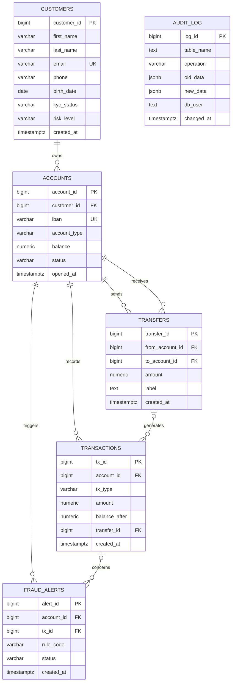

# NovaBank Core

Projet de conception, de sécurisation et d'administration d'une base de données PostgreSQL pour une banque en ligne fictive. Projet réalisé dans le cadre du Bachelor 2 Informatique.

## 1. Objectifs

- Structurer les données bancaires et garantir leur cohérence.
- Gérer les rôles, les privilèges et les accès aux données.
- Masquer les informations personnelles accessibles au support.
- Journaliser les modifications sensibles.
- Protéger le journal comptable contre les modifications, suppressions et TRUNCATE.
- Détecter certaines opérations potentiellement frauduleuses.
- Exécuter des virements de manière contrôlée.
- Étudier les performances des requêtes et des index.
- Vérifier les sauvegardes par une restauration.

## 2. Environnement technique

- Ubuntu Server
- PostgreSQL 18
- SQL et PL/pgSQL
- Bash
- Git et GitHub

## 3. Structure du projet

```text
novabank/
├── scripts/
│   ├── 00_tout_refaire.sh
│   └── 01_install_postgresql.sh
├── sql/
│   ├── 00_create_database.sql
│   ├── 01_create_schemas.sql
│   ├── 02_create_tables.sql
│   ├── 03_seed_data.sql
│   ├── 04_create_roles.sql
│   ├── 05_grant_permissions.sql
│   ├── 06_create_views.sql
│   ├── 07_create_updatable_view.sql
│   ├── 08_create_materialized_view.sql
│   ├── 09_create_indexes.sql
│   ├── 10_audit_trigger.sql
│   ├── 11_attach_audit_triggers.sql
│   ├── 12_protect_ledger.sql
│   ├── 13_fraud_alert_trigger.sql
│   ├── 14_balance_trigger.sql
│   └── 15_create_procedures.sql
├── captures/
│   ├── 01-tables-core.png
│   ├── 02-roles-postgresql.png
│   ├── 03-permissions-tables.png
│   ├── 04-audit-log.png
│   ├── 05-transactions-triggers.png
│   ├── 06-vues-securite.png
│   ├── 07-procedure-virement.png
│   └── 08-securite-procedure.png
└── README.md
```

## 4. Architecture de la base de données

La base utilise deux schémas : `core` pour les données métier et `audit` pour le journal d'audit.

### Schéma relationnel



Le schéma représente les principales relations métier. `audit.audit_log` conserve les événements d'audit ; il n'a pas de relation métier directe avec les tables de `core`.

## 5. Rôles et permissions

| Groupe | Fonction | Accès prévu |
|---|---|---|
| `analyst` | Analyse | Lecture des tables de `core` et de la vue matérialisée |
| `support` | Support client | Lecture des vues autorisées et mise à jour du statut KYC via la vue dédiée |
| `app` | Application | Exécution de la procédure de virement, sans accès direct aux tables métier |
| `auditor` | Audit | Lecture du journal `audit.audit_log` |

Comptes de connexion :

- `analyst_user` appartient à `analyst`.
- `support_user` appartient à `support`.
- `app_user` appartient à `app`.
- `auditor_user` appartient à `auditor`.

Les mots de passe sont configurés séparément avec `\password` et ne doivent pas être enregistrés en clair dans les fichiers SQL versionnés.

## 6. Sécurité et règles métier

### Vues

- `core.v_customers_masked` masque une partie des données personnelles.
- `core.v_customer_kyc` limite les modifications aux statuts KYC autorisés par la vue et son `CHECK OPTION`.
- `core.mv_account_summary` résume les comptes par type et statut. Son index unique permet le rafraîchissement concurrent.

### Audit et journal comptable

- Les déclencheurs d'audit enregistrent les opérations sensibles.
- Le journal `core.transactions` est protégé contre `UPDATE`, `DELETE` et `TRUNCATE`.
- Les déclencheurs de fraude repèrent les retraits importants et les virements sortants fréquents.

### Virements

La procédure `core.execute_transfer` :

- Vérifie le montant et les comptes concernés.
- Verrouille les comptes dans un ordre déterministe.
- Vérifie le solde disponible.
- Enregistre le virement et ses deux écritures comptables.
- Utilise `SECURITY DEFINER` et un `search_path` explicite.

## 7. Installation et reconstruction

Depuis le répertoire du projet :

```bash
# Installer et configurer PostgreSQL
sudo ./scripts/01_install_postgresql.sh

# Vérifier la syntaxe du script de reconstruction
bash -n scripts/00_tout_refaire.sh
```

Une reconstruction supprime la base `bankdb` et les rôles du projet. **Elle détruit les données existantes.** Vérifier le script et les sauvegardes avant de continuer.

Lorsque le script a été entièrement vérifié, la reconstruction se lance avec :

```bash
sudo ./scripts/00_tout_refaire.sh
```

Le script demande de saisir `RECONSTRUIRE` avant de supprimer la base. Il rejoue ensuite les scripts SQL numérotés dans l'ordre.

Après la reconstruction, configurer les mots de passe des comptes de connexion avec `\password` dans `psql`, sans placer de secrets dans le dépôt.

## 8. Tests et validation

Les vérifications doivent couvrir :

- Les contraintes des tables et la cohérence des données.
- Les permissions de chaque rôle et les accès interdits.
- Le masquage des informations et les limites de la vue KYC.
- Les événements d'audit.
- Le refus de `UPDATE`, `DELETE` et `TRUNCATE` sur le journal comptable.
- Les alertes de fraude, avec cas positifs et négatifs.
- Les virements valides et les erreurs attendues.
- Les index, les plans `EXPLAIN (ANALYZE, BUFFERS)` et les tailles des relations.
- Le rafraîchissement concurrent de la vue matérialisée.
- Une sauvegarde au format custom avec `pg_dump -Fc`, suivie d'une restauration avec `pg_restore` dans une base temporaire et d'une comparaison des nombres de lignes.

Les résultats définitifs doivent être documentés à partir des commandes réellement exécutées.

## 9. Captures d'écran

Les captures présentes dans `captures/` documentent les premières vérifications :

1. `01-tables-core.png` — tables du schéma principal.
2. `02-roles-postgresql.png` — rôles PostgreSQL.
3. `03-permissions-tables.png` — permissions.
4. `04-audit-log.png` — journal d'audit.
5. `05-transactions-triggers.png` — transactions et déclencheurs.
6. `06-vues-securite.png` — vues et sécurité.
7. `07-procedure-virement.png` — procédure de virement.
8. `08-securite-procedure.png` — tests de sécurité de la procédure.

## 10. Utilisation de l'intelligence artificielle

Une assistance par IA a été utilisée pour expliquer les concepts PostgreSQL, diagnostiquer des erreurs et organiser les vérifications. 

## 11. Livrables

- Scripts SQL numérotés.
- Scripts Bash d'installation et de reconstruction.
- README et schéma relationnel.
- Captures d'écran des vérifications.
